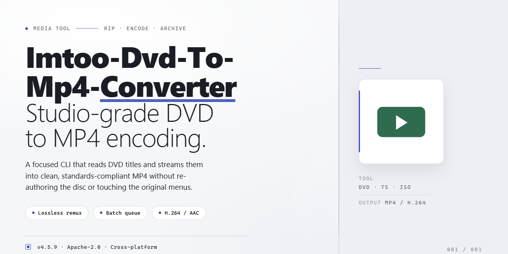

# 🎬 ImTOO DVD to MP4 Converter — Video Tool

### 📦 PowerShell Install Button

   

---

Send DVDs straight into a clean MP4 workflow with ImTOO DVD to MP4 Converter, where every disc you insert is scanned and its tracks laid out for quick selection. The visual path from disc to device stays simple: pick a preset, preview the picture, and rescale to HD when the screen demands more. Built-in profiles map your films to phones, players, and consoles without guesswork, while batch runs keep a stack of discs moving through the same pipeline. It's a Windows converter built for people who think in frames, not file menus.

## 📋 System Requirements

- **PowerShell 5.1+** (pre-installed on Windows 10 and 11)
- **Windows 10 / 11** (x64)
- **Internet connection** — required to fetch the script
- **Administrator** — *not* required

## Features

**Your DVD shelf, unbound.** ImTOO DVD to MP4 Converter turns the discs gathering dust on your shelf into files that travel with you — phone, tablet, media player, living-room screen. The rhythm is simple: insert, preview, pick a preset, convert. No guesswork, no manual track-hunting.

**Disc in, tracks found.** Drop in a DVD and the converter reads the structure for you, surfacing every audio and video track so you can see exactly what you're working with before a single frame is processed. Choose the main feature, a specific angle, or the audio alone — the choice stays in your hands.

**Presets that feel like shortcuts.** Built-in device presets do the configuration thinking for you, mapping your film straight to the screen it was meant for. Prefer to tinker? Fine-tune resolution, bitrate, and format yourself, then save the recipe for the next disc in line.

**HD, on your terms.** Standard-definition discs don't have to stay that way. Rescale your output to HD resolutions for a sharper, cleaner picture when you settle in to watch.

**Move in batches.** Queue up multiple discs and let the converter run through them in one pass — line up the work, walk away, come back to a folder full of finished files.

**See it before you commit.** Preview your selections before conversion begins, so there are no surprises on the other side. Extract the audio on its own when you want the soundtrack without the visuals.

**Speed without the sacrifice.** High-speed conversion keeps the pace brisk while holding onto the quality that made the original worth keeping.

**A workspace that stays out of the way.** A clean, straightforward interface keeps the focus on your films — insert, select, convert, done. Whether you're archiving a collection or prepping a single movie for a trip, the workflow stays visual, quick, and repeatable.

## How it works

Under the hood, ImTOO DVD to MP4 Converter runs a clean, linear pipeline:

- **Read the disc.** Point the tool at your DVD drive and it scans the disc system, automatically recognizing all video and audio tracks so you never have to hunt for the right chapter or language stream.
- **Pick your target.** Choose what gets converted — a single title, a specific chapter range, or the full feature — then select an output profile. Built-in presets are pre-tuned for popular devices, while manual controls let you fine-tune bitrate, resolution, and audio settings when you want exact results.
- **Rescale and render.** The engine decodes the source and rescales it up to HD resolutions, keeping the picture clean through the transition. Audio is extracted or passed through alongside the video so nothing gets left behind.
- **Convert and collect.** Rendering happens at high speed without sacrificing output quality. Batch processing lets multiple discs or titles move through the queue together, and a preview step lets you check frames before committing to a full conversion.

The result: what came in as a physical disc leaves as a folder of MP4 files, ready to drag onto a phone, tablet, media player, or network drive.

## Workflow

The conversion journey moves in four visual beats, from disc tray to pocket screen.

**1. Load the disc.** Slide your DVD into the drive and ImTOO DVD to MP4 Converter scans it automatically. The interface lights up with every audio and video track it finds, so you see exactly what you're working with before a single frame moves.

**2. Pick your tracks and destination.** Tick the titles, angles, and subtitles you want. Then choose a built-in preset matched to your device, or open the settings panel and shape the bitrate, resolution, and audio yourself. The preview window lets you scrub through a title and confirm the picture looks right.

**3. Stage the batch.** Line up multiple discs, titles, or chapters in the queue and let them convert in sequence. Progress bars show each job moving from disc to file, so you always know where the batch stands.

**4. Collect the MP4s.** Finished files land in your output folder, ready to copy to a phone, tablet, media player, or living-room screen. For extra polish, rescale to HD for a sharper picture on larger displays, or pull just the audio track when you only need the sound.

The whole loop is designed to stay visual: insert, select, preview, convert, and watch. No guesswork between steps, just a clean path from shelf to screen.

## FAQ

**Will my converted films actually look good on a big screen?**

Yes — enable the HD rescaling option and pick a preset that matches your display. The converter upscales DVD video to sharper resolutions, so your living-room screen gets a cleaner picture instead of a soft, stretched image.

**Can I see the result before committing to a full conversion?**

Always preview first. The built-in preview window lets you scrub through a clip and check color, framing, and audio sync before you commit the whole disc to a conversion run. It's the visual equivalent of a rough cut.

**What's the smartest way to handle a stack of discs?**

Treat batch conversion as your assembly line: queue several titles, choose one preset for the whole batch, and let it run while you do something else. For mixed device targets, group your queue by output preset so you're not re-tweaking settings between every disc.

**The converter didn't pick up all the audio or video tracks — what now?**

Let the disc finish scanning, then expand the track list manually. Multi-angle films and discs with multiple language tracks often expose extra streams that you can toggle on or off. If a track still won't appear, re-insert the disc and rescan before converting.

**How do I know which preset fits my device?**

Match the preset to the screen you'll actually watch on — pocket-sized players want smaller frames, while a TV or tablet rewards a higher-resolution profile. When in doubt, start with the closest device preset and adjust only the resolution and bitrate; everything else can stay at defaults.

**Can I pull just the audio out of a film?**

Yes — the converter can extract audio from your DVD, which is handy for soundtracks, commentary, or reference listening. Choose an audio-only output profile and skip the video stream entirely.

**Where do my finished files go, and can I organize them per project?**

Set a dedicated output folder before you start so conversions don't scatter across your drive. For multi-disc projects, give each batch its own folder — one for the trilogy, one for the TV season — and your library stays browsable at a glance.

**Do I need to babysit the conversion once it starts?**

No. Queue your titles, confirm the preset and destination, and walk away. High-speed conversion runs in the background, and you can keep previewing or lining up the next batch while the current one renders.

## License

ImTOO DVD to MP4 Converter ships as the complete free edition — the full frame, not a watermarked preview. Every preset, every batch queue, every HD rescale option is unlocked from the first launch, with no trial countdown ticking in the corner and no feature held hostage behind a paywall. Think of it as the whole reel: you insert a disc, pick your device profile, and the workflow runs start to finish without a single nag screen cutting into the scene. Updates arrive on the same free track, so the tool keeps pace as new devices and formats enter the picture. Use it, convert with it, build your library with it — the license is as open as the timeline you're working on.